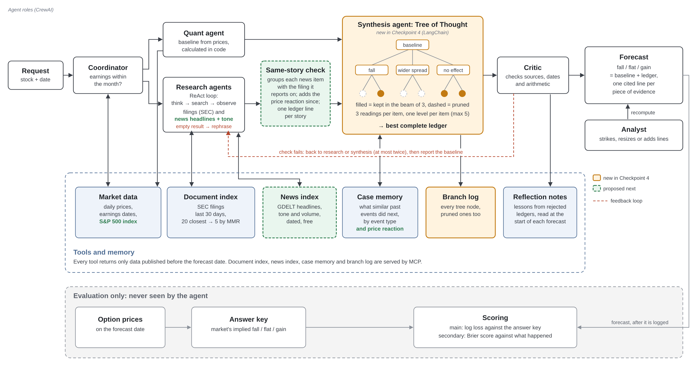

# MosAIc

MosAIc is a multi-agent system that estimates how a large US stock is likely to move over the next month, and explains its estimate line by line.

For one of 30 large-cap stocks and a date, it gives three probabilities: a large fall, a roughly flat month, or a large gain over the next 21 trading days. It starts from a baseline calculated from price history. It then reads the company's recent SEC filings and news, and adds a short ledger: each line shifts the probabilities by a small amount and quotes the passage it relies on.

The name comes from the "mosaic theory" of equity research, where analysts build a view from many small pieces of public information.

Capstone project for the CMU Agentic AI program, 2026.

## Who it is for

An equity analyst who wants a quick, checkable view of a stock before results or after news. Every number can be traced to a source, and the analyst can keep, resize or strike any line of the ledger.

## How a forecast is made



1. **Coordinator** checks whether results are due within the month.
2. **Quant agent** calculates the baseline from one year of prices. This is plain code.
3. **Research agent** searches the company's filings and news headlines, rephrasing searches that find nothing. It sees only short, cleaned extracts.
4. **Synthesis agent** turns the evidence into ledger lines. It uses Tree of Thought: for each piece of evidence it compares several readings (fall, gain, wider spread, no effect) against what happened after similar past events, and keeps the best combination.
5. **Critic** checks that every quote appears in its source, that every source was published before the forecast date, and that the numbers add up. A failed check goes back with its reason, at most twice. After that the system reports the baseline and says why.
6. **Risk gate** publishes the forecast, flags it, or holds it for the analyst, depending on how large the shift is, how much evidence supports it and whether the run had problems.

Every tool returns only data published before the forecast date, and every step is logged.

## How it is evaluated

The main test is how close the forecast gets to the probabilities implied by option prices on the forecast date. Option prices are used only for scoring and are never shown to the agent. Forecasts are also compared with what actually happened, and with simpler baselines (price history only, a prompt-only model, the agent without Tree of Thought).

Results so far are in [docs/results.md](docs/results.md).

## What is in this repository

| Path | What it is |
| --- | --- |
| `mosaic/` | The Python package. Currently the forecast definition, the option-based answer key, scoring and the run trace |
| `notebooks/` | Three tested notebooks: the Tree of Thought step on real filings, the baseline comparison, and the full multi-agent system with its guardrails. See [notebooks/README.md](notebooks/README.md) |
| `tests/` | Tests for the package and for the notebooks' code |
| `docs/design.md` | The design, the main decisions and how they changed during the program |
| `docs/results.md` | What the notebooks showed |
| `docs/figures/` | Architecture diagrams |

The agent code is being moved from the notebooks into the package, with a command-line tool. Until then, the multi-agent notebook is the way to run the whole system.

## Running it

**The multi-agent system, no setup needed:** open `notebooks/multi_agent/checkpoint5_multi_agent.ipynb` in Google Colab and choose Run all. It runs in seconds on a small synthetic company and shows nine scenarios, including the guardrails at work. To use a real model, set `MODE = "real"` in section 1 (needs a GPU runtime for Qwen, or an Anthropic API key).

**The tests, locally:**

```bash
pip install -e ".[dev]"
python -m pytest
```

The notebooks are built from their `notebook.src` files, which are easier to review and diff:

```bash
python notebooks/build.py notebooks/multi_agent/notebook.src notebooks/multi_agent/checkpoint5_multi_agent.ipynb
```

## Data

All data is public: SEC EDGAR filings, GDELT news headlines and daily prices. Option prices for scoring come from FirstRate Data and are not included in this repository.
