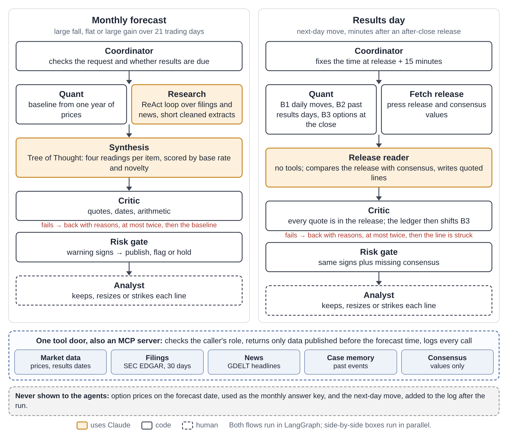
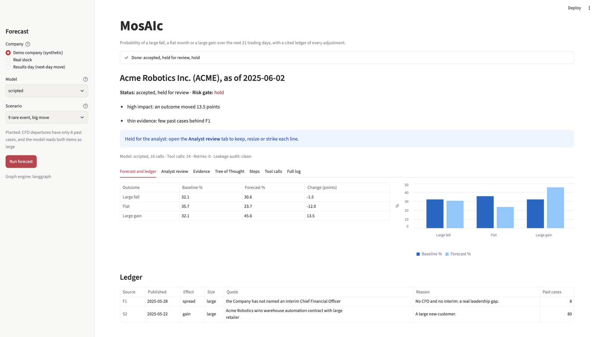
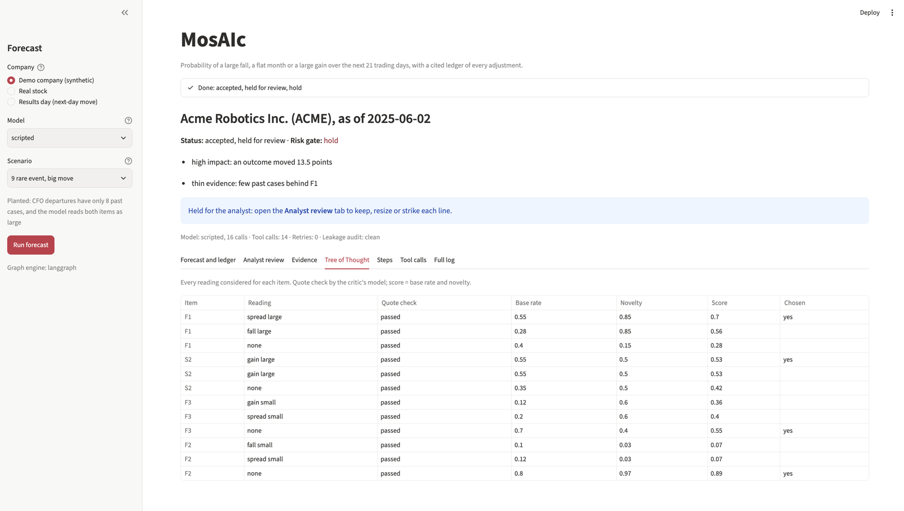
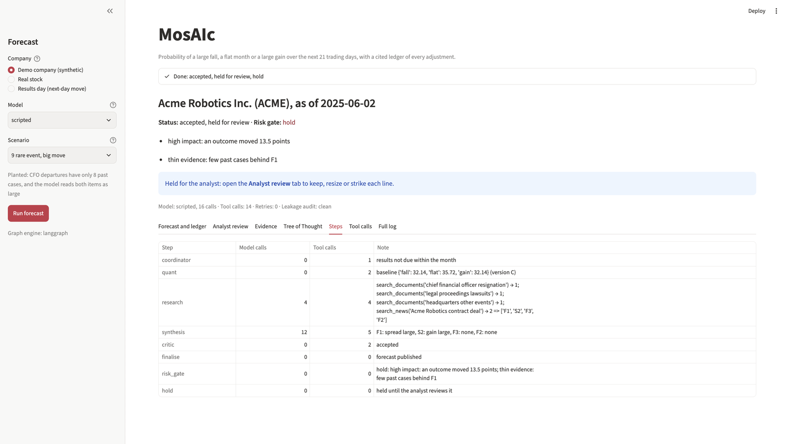
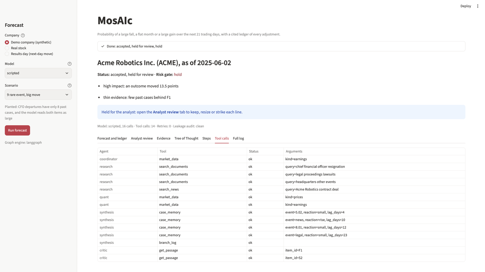
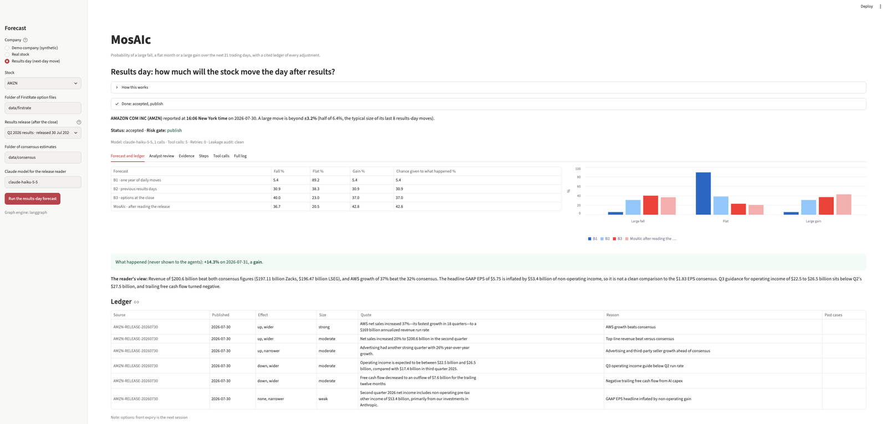

# MosAIc

MosAIc is a multi-agent system that estimates how a large US stock is likely to move over the next month, and explains its estimate line by line.

For one of 30 large-cap stocks and a date, it gives three probabilities: a large fall, a roughly flat month, or a large gain over the next 21 trading days. It starts from a baseline calculated from price history. It then reads the company's recent SEC filings and news, and adds a short ledger: each line shifts the probabilities by a small amount and quotes the passage it relies on.

The name comes from the "mosaic theory" of equity research, where analysts build a view from many small pieces of public information.

Capstone project for the CMU Agentic AI Program: Building Autonomous Systems for Real-World Applications, 2026.

## Who it is for

An equity analyst who wants a quick, checkable view of a stock before results or after news. Every number can be traced to a source, and the analyst can keep, resize or strike any line of the ledger.

## How a forecast is made



1. **Coordinator** checks whether results are due within the month.
2. **Quant agent** calculates the baseline from one year of prices. This is plain code.
3. **Research agent** searches the company's filings and news headlines, rephrasing searches that find nothing. It sees only short, cleaned extracts.
4. **Synthesis agent** turns the evidence into ledger lines. It uses Tree of Thought: for each piece of evidence it compares several readings (fall, gain, wider spread, no effect) against what happened after similar past events, and keeps the best combination.
5. **Critic** checks that every quote appears in its source, that every source was published before the forecast date, and that the numbers add up. A failed check goes back with its reason, at most twice. After that the system reports the baseline and says why.
6. **Risk gate** publishes the forecast, flags it, or holds it for the analyst, depending on how large the shift is, how much evidence supports it and whether the run had problems.

Every tool returns only data published before the forecast date, and every step is logged.

## What it looks like

The screenshots below come from the Streamlit app (`streamlit run app.py`). The first four show one forecast on the synthetic demo company, scenario 9 ("rare event, big move"), where the guardrails are meant to hold the forecast for the analyst. The last shows results day on a real release.

**1. Forecast and ledger.** The *quant agent*'s baseline (dark bars) and the forecast after the ledger (light bars). Each ledger line was written by the *synthesis agent*, quotes its source and passed the *critic*'s checks. The *risk gate* found two warning signs, a 13.5-point move and a line resting on only 8 past cases, so it held the forecast. The analyst can now keep, resize or strike each line in the **Analyst review** tab.



**2. Tree of Thought.** Every reading the *synthesis agent* considered for each evidence item. Each reading has its quote check, its base rate from past events, its novelty and its score, and the beam search marks the combination it chose. This is the step evaluated in `docs/results.md`.



**3. Steps.** The flow in Figure 1, one row per step: what each agent did, how many model and tool calls it made, and its note. Here the *research agent* ran four searches, the *synthesis agent* chose the readings, the *critic* accepted them and the *risk gate* held the forecast.



**4. Tool calls.** Every call through the tool door, with the agent that made it and the result. Each agent only reaches the tools its role allows, and a refused call would show here and count as a warning sign.



**5. Results day.** Amazon's Q2 2026 release. The three baselines are computed in code: B1 from daily moves, B2 from past results-day moves and B3 from the option prices at the close. The *release reader* compares the release with the analysts' consensus and writes a quoted ledger, which shifts B3 into MosAIc's forecast. What happened the next day is shown only after the run and is never given to the agents.



## How it is evaluated

The main test is how close the forecast gets to the probabilities implied by option prices on the forecast date. Option prices are used only for scoring and are never shown to the agent. Forecasts are also compared with what actually happened, and with simpler variants: price history only, a prompt-only model, the baseline adjusted from the model's memory, and the agent without Tree of Thought.

The results are in [docs/results.md](docs/results.md). In short, no variant got closer to the option market than the price baseline, because most of the news is already in the price. That led to the second mode, results day (below). [docs/tree_of_thought.md](docs/tree_of_thought.md) follows how Tree of Thought was tested, step by step, against the controls from the course lab.

## What is in this repository

| Path | What it is |
| --- | --- |
| `mosaic/` | The Python package: the agents, tools, graph, guardrails, risk gate, demo world and scenarios, the option-based answer key and scoring, and the command-line tool |
| `notebooks/` | Three tested notebooks: the Tree of Thought step on real filings, the baseline comparison, and the full multi-agent system with its guardrails. See [notebooks/README.md](notebooks/README.md) |
| `tests/` | Tests for the package and for the notebooks' code |
| `docs/design.md` | The design, the main decisions and how they changed during the program |
| `docs/tree_of_thought.md` | How Tree of Thought was built and tested, step by step, and what it really adds |
| `docs/results.md` | All results: the notebooks, the guardrail ablation, the evaluation on real stocks and the results-day demonstration |
| `docs/figures/` | Architecture diagrams. `figure1_final.png` is the final system, and the other files are earlier checkpoints |
| `results/` | The guardrail ablation and design comparison on the demo scenarios, and `evaluation_summary.md` with the averaged scores of every evaluation run. The per-forecast files use licensed option data and stay out of the repository |

The notebooks are where each part was first tested. The package holds the final version of the same code.

## Running it

**From the command line** (Python 3.10 or later):

```bash
pip install -e .
python -m mosaic.cli --demo                         # one forecast on the demo company
python -m mosaic.cli --demo --scenario all          # the nine guardrail scenarios
python -m mosaic.cli --demo --backend anthropic     # the demo company with Claude (needs ANTHROPIC_API_KEY)
```

Each forecast writes `report.md` (probabilities, ledger, review decision), `state.json` and `trace.jsonl` (every step and tool call, with the leakage audit) under `runs/`.

**A real stock** needs internet access, a few extra packages, a contact for the SEC (its rule for automated access) and, for Claude, an Anthropic API key. Put the last two in a `.env` file once (copy `.env.example`; git ignores `.env`, so it never reaches GitHub):

```bash
pip install -e ".[retrieval,prices,llm]"
cp .env.example .env                               # then fill in ANTHROPIC_API_KEY and MOSAIC_SEC_USER_AGENT
python -m mosaic.cli AAPL --as-of 2026-07-15 --backend anthropic --model claude-haiku-5-5
```

Filings, prices and news are cached under `data/`, so a second run on the same stock is fast.

Claude thinks before each answer by default. `MOSAIC_LLM_THINKING=off` turns this off, as in the first evaluation.

**Other ways to run the agents.** `--backend crewai` runs the model-backed agents as CrewAI agents (`pip install -e ".[crew]"`). The tools can also be served as a real MCP server, which any MCP client can call; the forecast-date rule runs inside each tool:

```bash
pip install -e ".[mcp]"
python -m mosaic.mcp_server --demo                  # or --ticker AAPL --as-of 2026-07-15
```

**The guardrail ablation** reruns the nine scenarios with each guardrail switched off in turn, and compares the design with simpler setups. It needs no internet and writes the tables in `results/`:

```bash
python -m mosaic.ablation
```

**The evaluation on real stocks** forecasts every Wednesday from July 2026 (after the Claude models' knowledge cutoff) with five variants: baseline, prompt only, baseline with the model's memory, single pass and Tree of Thought. It first asks the model whether it remembers what the stock did, and reports scores with and without those dates. With `--options-dir` pointing at a folder of FirstRate option files, the main score is log loss against the option-implied probabilities. The run reported in `docs/results.md`:

```bash
python -m mosaic.evaluate --backend anthropic --model claude-haiku-5-5 \
  --tickers AAPL,MSFT,JPM --start 2026-07-01 --end 2026-08-19 \
  --options-dir data/firstrate --out results/evaluation_thinking
```

Useful options:

- `--limit 2` for a cheap first try, and `--resume` to continue an interrupted run.
- `--news-offline` uses only news already saved on disk and never calls GDELT, so a rerun sees the same news and does not wait on refused requests.

GDELT refuses calls that come too fast. To save its headlines in advance, slowly, for a few stocks (it can be stopped and restarted, and saved days are skipped):

```bash
python -m mosaic.news_download --tickers AMZN,GOOGL,NVDA --start 2026-07-01 --end 2026-08-19 \
  --also 2026-07-08,2026-07-30 --spacing 15
```

Where saved Wayback news also exists, forecasts use both sources together.
- `--thinking off` reproduces the first run, without thinking.
- `--variants "baseline,5 single passes"` runs a sixth variant on its own: one research step, then the single pass five times, averaged. It checks whether Tree of Thought adds more than repeating and averaging.

**Results day: forecasting right after results.** For a stock that reports after the close, the agents forecast the move to the next day's close, a few minutes after the release. It runs as a second LangGraph flow built from the same parts as the monthly forecast (`mosaic/results_graph.py`):

```
coordinator ─┬─> quant: B1, B2, B3 ───────┐
             └─> fetch release (code) ────┴─> release reader (agent) ─> critic ─┬─> finalise ─┐
                                                       ^                         ├─> fallback ─┴─> risk gate ─> publish | flag | hold
                                                       └─── back with reasons ───┘
```

- **Baselines, known before the release:** B1 from a year of daily moves, B2 from the last eight results-day moves, B3 from the option prices at the close (FirstRate files).
- **The release reader** reads the press release (the 8-K's Exhibit 99.1) against the baselines and the analysts' consensus (`data/consensus/<TICKER>_<date>.json`, values only), and writes a ledger with exact quotes. It has no tools.
- **The critic** checks every quote in code and sends failing lines back with reasons, at most twice. The ledger then tilts B3 into MosAIc's forecast, and the risk gate publishes, flags or holds it for the analyst, who can keep, resize or strike each line.
- **Same safeguards:** the release reaches the agents only through the tool door, with role checks and the forecast-date rule. The next day's price is never shown to them.

```bash
python -m mosaic.results_day AMZN 2026-07-30 --options-dir data/firstrate          # the three baselines only
python -m mosaic.results_day AMZN 2026-07-30 --options-dir data/firstrate --read   # the full flow, with Claude
```

It is also the third choice in the app's sidebar. It has been run on three releases as a demonstration (`docs/results.md`, section 6). Evaluating it needs many more releases.

**In the browser** (a simple Streamlit screen):

```bash
pip install -e ".[ui]"
streamlit run app.py
```

Choose the demo company and a scenario, a real stock, or results day, press **Run forecast**, and see the forecast against the baseline, the ledger with its sources and dates, the risk gate's decision, and how the agents got there: evidence, every Tree of Thought reading with its scores, each step and each tool call. A held forecast can be reviewed line by line (keep, resize or strike).

**In a notebook, no setup needed:** open `notebooks/multi_agent/checkpoint5_multi_agent.ipynb` in Google Colab and choose Run all. It runs in seconds on a small synthetic company and shows nine scenarios, including the guardrails at work. To use a real model, set `MODE = "real"` in section 1 (needs a GPU runtime for Qwen, or an Anthropic API key).

**The tests, locally:**

```bash
pip install -e ".[dev]"
python -m pytest
```

The notebooks are built from their `notebook.src` files, which are easier to review and diff:

```bash
python notebooks/build.py notebooks/multi_agent/notebook.src notebooks/multi_agent/checkpoint5_multi_agent.ipynb
```

## Data

Filings (SEC EDGAR), news headlines (GDELT) and daily prices are public. Option prices come from FirstRate Data and are licensed, so they are not included in this repository. The analysts' consensus estimates used by results day are not included either. Each one is a small JSON file in `data/consensus/` with the metric, provider, value and date. `mosaic/firstrate.py` reads their files as they come (one file per stock and quarter, plain or zipped). The files have no stock price column, so the price is taken from the daily closes or, failing that, worked out from the option prices themselves (put-call parity).
